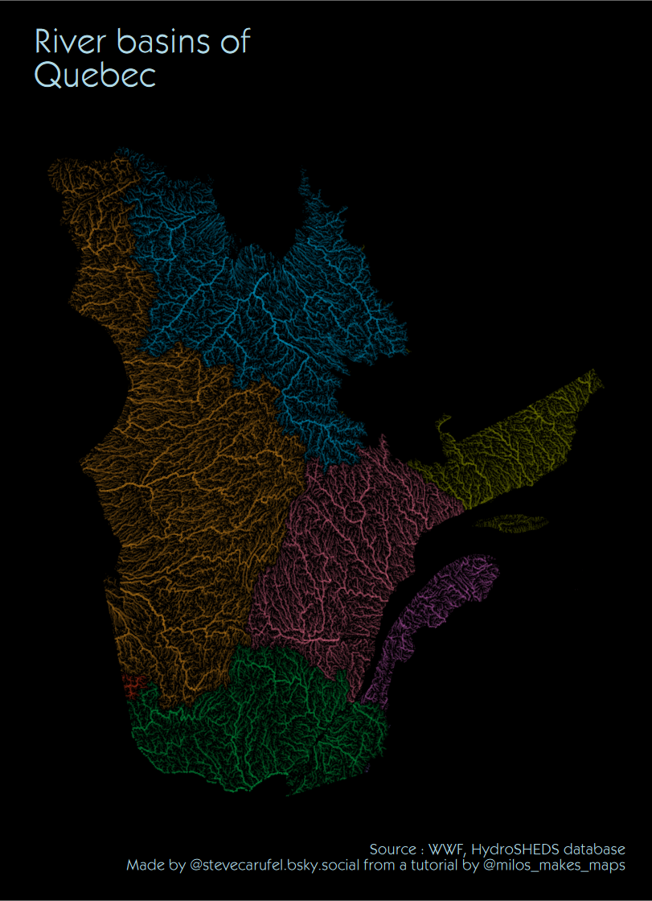

# major-watersheds-of-quebec
Une carte des grands bassins versants du Québec - A map of Quebec's major river basins

Thanks to this tutorial https://www.youtube.com/watch?v=HugGwjogPv0

## A somewhat brighter version than the original from the tutorial's code : 

